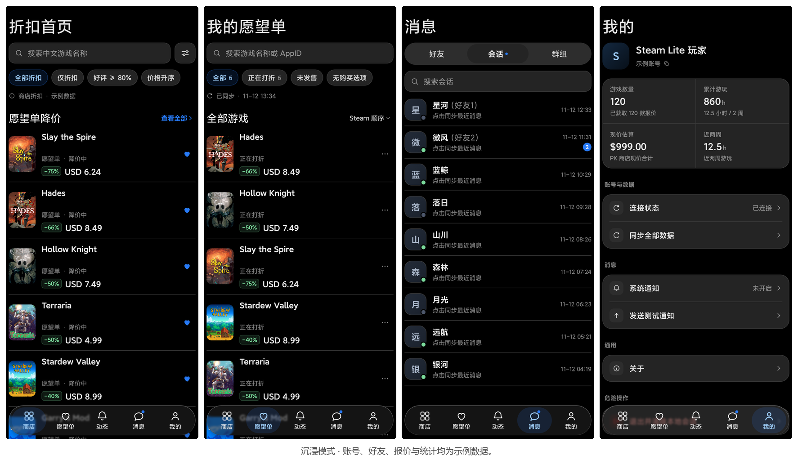

<div align="center">

# Steam Lite

**原生 Android Steam 客户端 · 商店与愿望单 · 好友聊天 · 动态**

[](https://github.com/zianyx6/steamlite/actions/workflows/android.yml)

[](https://github.com/zianyx6/steamlite/releases/download/v1.0.1/SteamLite-1.0.1.apk)

### [⬇️ 直接下载 SteamLite-1.0.1.apk](https://github.com/zianyx6/steamlite/releases/download/v1.0.1/SteamLite-1.0.1.apk)

[发行说明与全部附件](https://github.com/zianyx6/steamlite/releases/latest) · [问题反馈](https://github.com/zianyx6/steamlite/issues) · [MIT License](LICENSE)

Android 8.0 及以上 · 包名 `org.steamlite` · 无需自行编译

</div>

## 界面预览



预览图使用当前源码在真机沉浸模式下拍摄，账号、好友、报价和统计均为示例数据。图中的 Miuix 界面可按下方开发说明构建。

Miuix 主题跟随系统深浅色。悬浮底栏避开系统手势区，键盘弹出时自动收起。Android 13 及以上支持实时玻璃折射，Android 8 至 12 使用普通悬浮底栏。

## 安装

1. 下载上方的 **SteamLite-1.0.1.apk**。
2. 在 Android 上打开 APK，按系统提示允许该下载来源安装应用。
3. 使用相同签名的旧版本可直接覆盖升级并保留本地数据。
4. 进入“我的”登录 Steam。可等待官方手机应用批准，也可直接提交 Steam Guard 令牌码；按 Steam 实际提供的认证方式完成登录。

应用直接连接 Steam，会话由 Android Keystore 保护。密码不保存在应用中，也不发送至开发者服务器。

## 功能

- **商店与愿望单**：游戏封面、折扣售价、搜索筛选、游戏详情、愿望单添加与移除回读确认。
- **好友与会话**：在线状态、按游戏人数分组、Steam 置顶与备注、灰色括号备注、滑动操作菜单、未读蓝点。
- **聊天**：实时私聊与历史补拉、图片发送/查看/保存、Steam 表情与 APNG 动态贴纸、好友私聊语音通话。
- **后台消息**：登录后通过前台服务维持 Steam 连接并接收消息通知。通知受系统授权、网络和省电策略影响。
- **群组**：群组侧栏、文字频道、群头像与群聊历史。
- **动态**：好友 Steam 活动、图片预览与原图查看。
- **我的**：游戏数量、游玩时长与已获取报价估算；统一“同步全部数据”入口。

底栏顺序为 **商店 → 愿望单 → 动态 → 消息 → 我的**，首次进入消息页默认显示“会话”。已访问的标签页会保留列表位置，商店、动态和消息页支持下拉刷新。

## 已知边界

- 1.0.1 在 Android 12 MuMu 验证了覆盖安装和后台服务启动。当前界面在 Android 16 真机验证了深浅色、标签切换、商店滚动、键盘和手势区适配。长时间锁屏、厂商省电策略及登录后的长列表仍待扩大验证。
- 语音通话限好友私聊与前台使用；群语音、视频通话和完整群管理尚未提供。
- 需要能够访问 Steam 社区、聊天与图片 CDN。限流时会停止继续查询价格，保留已加载数据；完整同步可能有部分项目未完成。
- 商店报价采用 PK/USD 查询上下文，游戏价值是已获得的当前报价合计，不是购买支出；价格观察不代表全历史最低价。
- 真实手机确认/令牌双通道的所有竞争与异常场景、群组在线头像，以及部分网络下的整轮同步仍需持续验收。

完整说明见 [KNOWN_ISSUES.md](KNOWN_ISSUES.md)。

## 开发

项目使用 Kotlin、Jetpack Compose、Miuix、JavaSteam、Room、OkHttp 和 Coil。构建需要 JDK 21、Android SDK Platform 37（`platforms;android-37.0`）和 Build Tools 36.0.0。仓库的 Gradle Wrapper 使用 Gradle 9.9.1，应用的最低 API 为 26，目标 API 为 34。

```sh
./gradlew testDebugUnitTest assembleDebug
```

Windows PowerShell 可用 `.\gradlew.bat testDebugUnitTest assembleDebug`。调试 APK 位于 `app/build/outputs/apk/debug/app-debug.apk`。构建、签名和设备检查见 [docs/BUILDING.md](docs/BUILDING.md)，发布记录见 [CHANGELOG.md](CHANGELOG.md)。

本项目为非官方开源客户端，与 Valve 无关联。Steam 商标属于其权利人。源码采用 MIT 许可证，第三方信息见 [DEPENDENCIES.md](DEPENDENCIES.md) 和 [third-party/](third-party/)。
