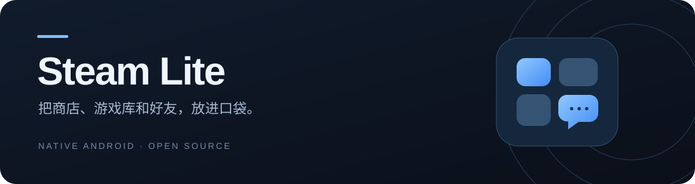
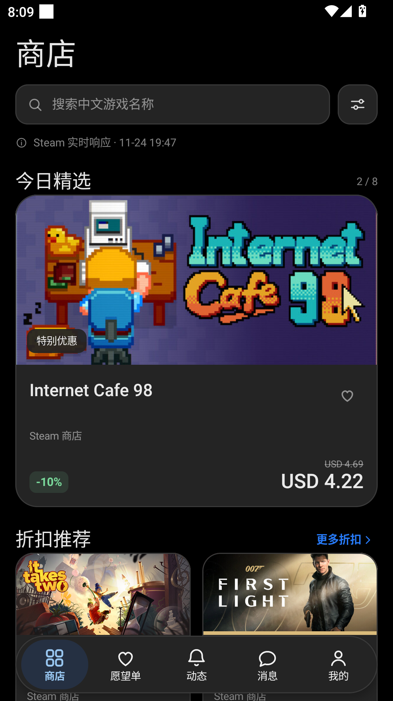
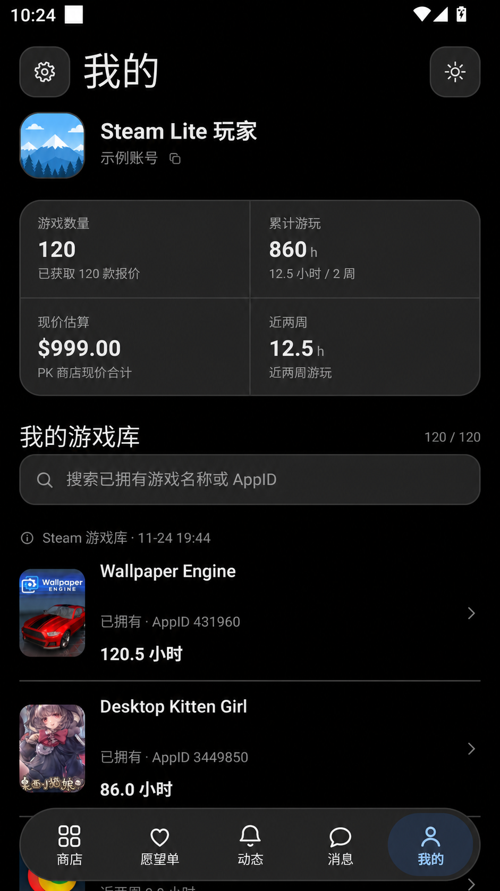
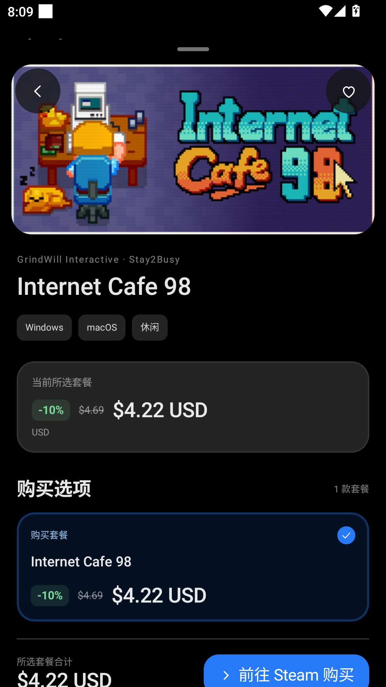
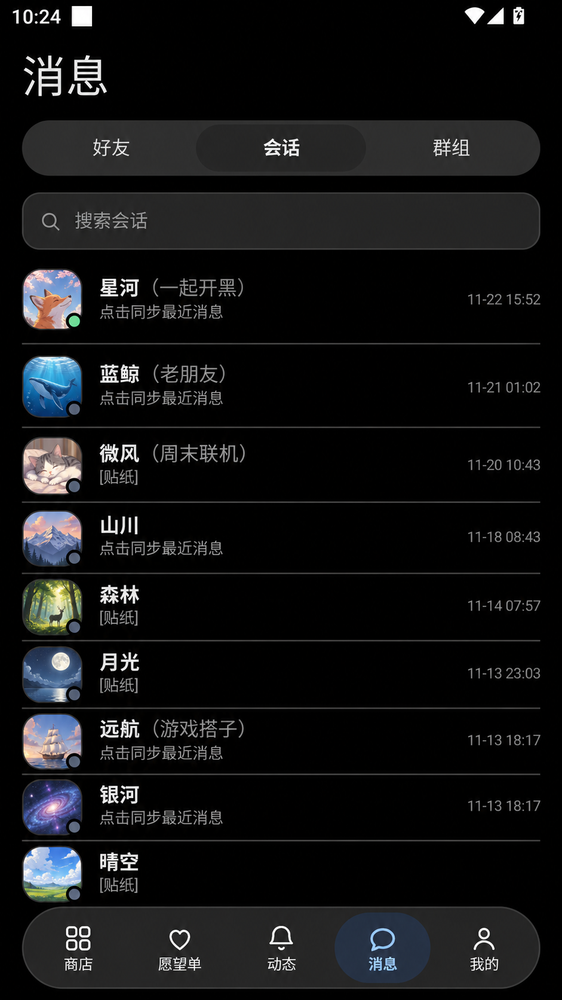

<div align="center">



**原生 Android Steam 客户端**

逛商店、看动态、找好友，也把自己的游戏库随身带走。

[](https://github.com/zianyx6/steamlite/actions/workflows/android.yml)  [](LICENSE)

<br>

<a href="https://github.com/zianyx6/steamlite/releases/download/v1.0.5/SteamLite-1.0.5.apk"></a>

Android 8.0 及以上 · 可覆盖升级 · 无需自行编译

[更新日志](CHANGELOG.md)　 / 　[全部版本](https://github.com/zianyx6/steamlite/releases)　 / 　[问题反馈](https://github.com/zianyx6/steamlite/issues)

</div>

## 界面预览

沿用 Miuix 设计语言，以大封面、清晰的信息层级和悬浮导航串联五个页面。

<table align="center">
  <tr>
    <td align="center" width="50%"><br><strong>商店</strong><br><sub>大封面精选 · 双列推荐 · 隐藏已拥有游戏</sub><br><br><a href="docs/screenshots/store-1.0.4.png"></a><br><br></td>
    <td align="center" width="50%"><br><strong>我的游戏库</strong><br><sub>个人数据 · 已拥有游戏 · 随时搜索</sub><br><br><a href="docs/screenshots/library-1.0.4.png"></a><br><br></td>
  </tr>
  <tr>
    <td align="center"><br><strong>游戏详情</strong><br><sub>封面与资料 · 真实套餐 · 价格一目了然</sub><br><br><a href="docs/screenshots/detail-1.0.4.png"></a><br><br></td>
    <td align="center"><br><strong>好友与会话</strong><br><sub>Steam 备注 · 图片与贴纸 · 私聊语音</sub><br><br><a href="docs/screenshots/messages-1.0.4.png"></a><br><br></td>
  </tr>
</table>

<details>
<summary>查看原图与隐私处理说明</summary>

点击截图可查看原图。展示图基于 1.0.4 在 Android 12 MuMu 中的真实界面截图（1.0.5 的价格与估价会跟随账号地区）；个人主页与会话页经 AI 隐私编辑，头像、昵称、账号及个人统计替换为演示信息，排版细节可能略有差异。商店与详情页保留实拍画面，报价仅代表拍摄时的数据。

主题支持深浅色切换与跟随系统。悬浮底栏避开系统手势区，键盘弹出时自动收起；Android 13 及以上支持实时玻璃折射，Android 8 至 12 使用普通悬浮底栏。

</details>

## 随手打开，就能做这些

| 逛一逛商店 | 和好友保持联系 |
| :--- | :--- |
| **商店与愿望单**<br>精选推荐、真实套餐与评价摘要；首页隐藏已拥有游戏。 | **好友与聊天**<br>置顶与备注、游戏分组、图片、表情、动态贴纸和私聊语音。 |
| **自己的游戏库**<br>个人数据与游戏搜索，临时断线保留本地缓存。 | **动态与群组**<br>好友活动与图片、群组侧栏、文字频道与群聊历史。 |
| **更顺手的浏览**<br>下拉刷新、列表位置保留，图片放大、切换与下载。 | **登录与会话恢复**<br>扫码与密码登录、手机确认与令牌码，保存会话并尝试重连。 |

## 三步开始

1. **下载安装**：下载 [SteamLite-1.0.5.apk](https://github.com/zianyx6/steamlite/releases/download/v1.0.5/SteamLite-1.0.5.apk)，在 Android 上打开，按系统提示允许安装。相同签名的旧版本可直接覆盖升级。
2. **登录 Steam**：进入“我的”，使用另一台设备上的 Steam Guard 扫码，或输入账号密码。可等待手机确认，也可提交令牌码，按 Steam 提供的方式完成验证。
3. **开始使用**：底栏依次为商店、愿望单、动态、消息、我的。消息默认进入“会话”；统一同步与其他设置位于“我的”左上角。

应用直接连接 Steam，会话由 Android Keystore 保护。密码不保存在应用中，也不发送至开发者服务器。

## 使用说明

<details>
<summary>连接、后台运行与当前功能边界</summary>

- 1.0.4 在 Android 12 MuMu 验证了覆盖安装、重启后恢复会话、游戏库缓存与搜索、独立设置页，以及真实购买套餐和评价摘要。长时间锁屏、厂商省电策略和更多真机环境仍待扩大验证。
- 1.0.5 已验证 PK / USD 登录账号的商店、详情与估价一致；CNY、JPY 已完成公开报价对照与格式测试，其他地区账号的完整登录实测仍待扩大。
- 需要能够访问 Steam 社区、聊天与图片 CDN。后台连接和通知受网络、系统通知授权与省电策略影响。
- 语音通话限好友私聊与前台使用；群语音、视频通话和完整群管理尚未提供。
- 价格限流时停止继续查询并保留已加载数据，完整同步可能有部分项目未完成。
- 登录后商店、愿望单与游戏库估价跟随 Steam 账号的商店地区和币种，价格缓存按地区隔离。游戏价值为已获得的当前报价合计，不代表购买支出，价格观察不代表全历史最低价。
- 手机确认与令牌双通道的所有竞争和异常场景、群组在线头像，以及部分网络下的整轮同步仍需持续验收。

完整说明见 [KNOWN_ISSUES.md](KNOWN_ISSUES.md)。

</details>

<details>
<summary>开发与本地构建</summary>

使用 Kotlin、Jetpack Compose、Miuix、JavaSteam、Room、OkHttp 和 Coil。

| 构建环境 | 版本 |
| :--- | :--- |
| JDK | 21 |
| Android SDK Platform | 37（`platforms;android-37.0`） |
| Build Tools | 36.0.0 |
| Gradle Wrapper | 9.9.1 |
| 最低 / 目标 API | 26 / 34 |

```sh
./gradlew testDebugUnitTest assembleDebug
```

Windows PowerShell 使用 `.\gradlew.bat testDebugUnitTest assembleDebug`。调试 APK 位于 `app/build/outputs/apk/debug/app-debug.apk`。

[构建与签名](docs/BUILDING.md) · [第三方依赖](DEPENDENCIES.md) · [第三方许可](third-party/)

</details>

---

<div align="center">

**Steam Lite** · 为随时打开 Steam 而做

非官方开源客户端，与 Valve 无关联。Steam 商标属于其权利人。<br>
源码采用 [MIT License](LICENSE)。

</div>
